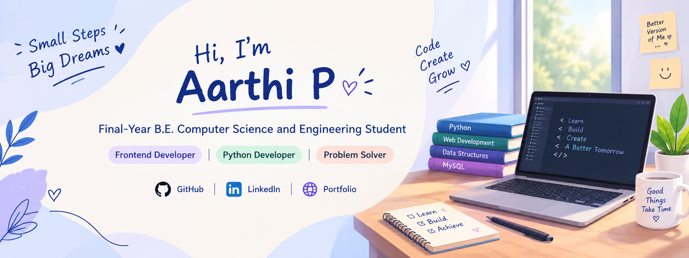

<!-- ================= PROFILE BANNER ================= -->

 

# Hi, I'm Aarthi P 👋

### Final-Year B.E. Computer Science and Engineering Student

  <a href="https://github.com/Aarthi3125">GitHub</a> ·
  <a href="https://linkedin.com/in/aarthi-periyasamy/">LinkedIn</a> ·
  <a href="https://aarthi3125.github.io/Aarthi-P-profile/">Portfolio</a>

**Frontend Development | Python | Web Applications**

---

## 👩‍💻 About Me

Hello! I'm **Aarthi P**, a final-year B.E. Computer Science and Engineering student at Paavai Engineering College. I enjoy creating responsive websites and practical software applications.

- 🎓 B.E. Computer Science and Engineering (2023–2027)
- 💻 Interested in Frontend Development and Python Development
- 🌱 Learning web technologies and application development
- 🚀 Building projects that solve practical problems
- 🤝 Interested in internships and entry-level software development opportunities

---

## 🛠️ Technical Skills

### Programming Languages & Web Development

### Backend & Database

### Development Tools

**Core Concepts:** Object-Oriented Programming Basics · Data Structures Basics · DBMS · SQL

---

## 🚀 Featured Projects

### 🏥 MediQ — E-Hospital Queue Management System

A web application concept focused on simplifying hospital appointment booking and patient queue management.

- Appointment booking and doctor selection
- Digital token generation
- Patient queue tracking
- Designed to reduce manual queue management

**Technologies:** Python, Flask, HTML, CSS, JavaScript, MySQL

### 🤖 AI-Powered Interactive Classroom for Rural Children

**Status: Ongoing**

An interactive learning project designed to encourage classroom participation and confidence among rural students.

- Interactive quizzes and learning activities
- Student participation tracking
- Personalized practice and learning support
- Activities to encourage active participation

**Technologies:** Python, Flask, HTML, CSS, JavaScript, MySQL

### 🌐 Personal Portfolio Website

A personal website showcasing my technical skills, projects, and professional profile.

- Responsive website layout
- Simple and user-friendly interface
- Project and profile information

**Technologies:** HTML, CSS, JavaScript

[Visit my portfolio](https://aarthi3125.github.io/Aarthi-P-profile/)

---

## 💼 Internship Experience

### Frontend Development Intern — GreenPixelTech

- Practiced responsive web page development using HTML, CSS and JavaScript
- Worked on frontend implementation and user interface development
- Developed portfolio and restaurant website projects

### Virtual Internship — Alteryx

- Participated in a virtual internship focused on data analytics and process automation

### Virtual Internship — Google Android Developer

- Participated in an Android development virtual internship

---

## 📜 Certifications

- **Artificial Intelligence** — IBM SkillsBuild | February 2026
- **Cloud Computing and Distributed Systems** — NPTEL | 2025
- **Database Management Systems** — NPTEL | 2025
- **Basics of Python** — Infosys Springboard | February 2025

---

## 🎯 Current Goals

- Strengthen my frontend development skills
- Improve my Python programming knowledge
- Build and document practical projects
- Learn better coding practices and version control
- Prepare for software development internships and entry-level opportunities

---

## 🐍 Contribution Snake

---
## 🐍 GitHub Contribution Snake

### 🤝 Thanks for visiting my profile!

*Learning, building, and improving one project at a time.* 💙

<a href="https://github.com/Aarthi3125">GitHub</a> ·
<a href="https://linkedin.com/in/aarthi-periyasamy/">LinkedIn</a> ·
<a href="https://aarthi3125.github.io/Aarthi-P-profile/">Portfolio</a>

